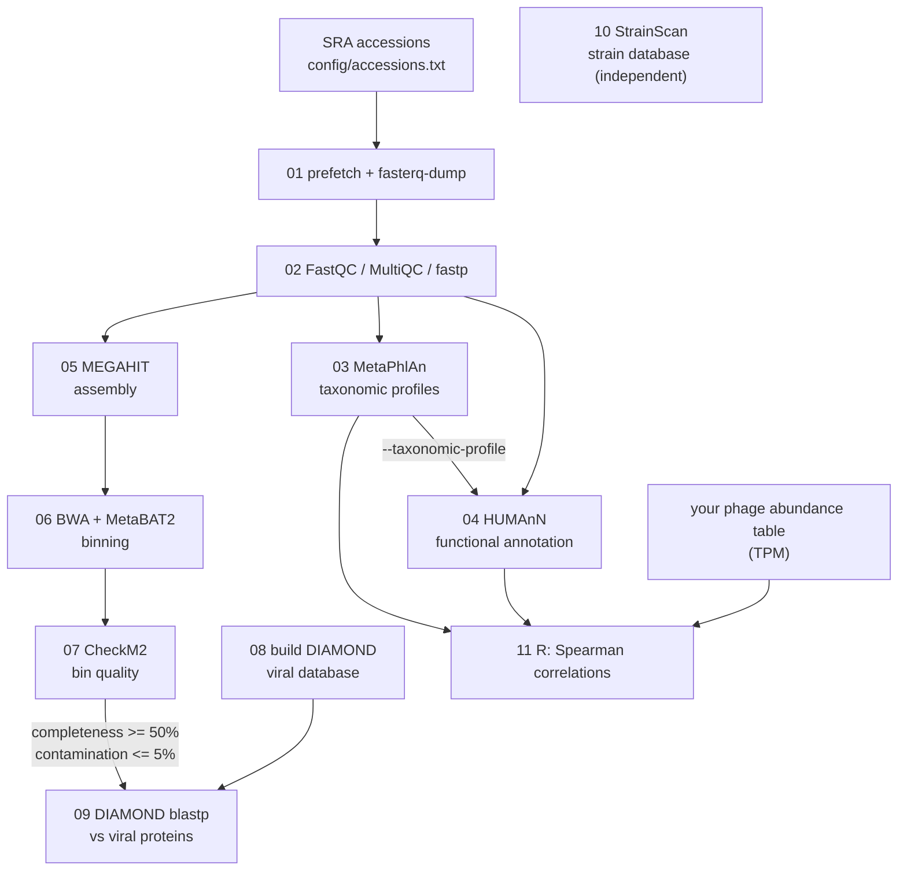

The aim of this study is to identify the plant-growth promoting microbes of the Atacama desert that can survive harsh environmental conditions. We performed large scale analysis of all the publicly available microbiome datasets (16S amplicon and Whole metagenome) of this region. The codes used for the analysis are provided here.

# Atacama Microbiome: Shotgun Metagenomics Workflow

A step-by-step, resumable shell workflow for shotgun metagenomic data. It goes from raw SRA
downloads to read QC, taxonomic profiling (MetaPhlAn), functional annotation (HUMAnN), assembly,
binning, bin quality assessment, viral protein screening of high-quality bins, strain-level database
construction, and R scripts that correlate *Cutibacterium acnes* with bacteriophages and
bacteriophages with bacterial pathways.

## Workflow



| Step | Script | Main tools | Key output |
|------|--------|-----------|------------|
| 1 | `01_download_sra.sh` | sra-tools, pigz | `data/raw/<run>_{1,2}.fastq.gz` |
| 2 | `02_quality_control.sh` | FastQC, MultiQC, fastp | `data/trimmed/`, `results/02_qc/` |
| 3 | `03_taxonomic_profiling.sh` | MetaPhlAn | `results/03_metaphlan/merged_abundance_table.txt` |
| 4 | `04_functional_annotation_humann.sh` | HUMAnN | `results/04_humann/merged/merged_pathabundance_cpm.tsv` (+ gene families, pathway coverage) |
| 5 | `05_assembly.sh` | MEGAHIT | `results/05_assembly/contigs/<run>.fa` |
| 6 | `06_binning.sh` | BWA, samtools, MetaBAT2 | `results/06_binning/<run>/bins/bin.*.fa` |
| 7 | `07_bin_quality_checkm2.sh` | CheckM2 | `results/07_checkm2/all_samples_quality_report.tsv` |
| 8 | `08_build_viral_diamond_db.sh` | DIAMOND | `databases/ncbi_viral/diamond_viral_db.dmnd` |
| 9 | `09_viral_search_bins.sh` | DIAMOND | `results/09_viral_hits/all_viral_hits.tsv` |
| 10 | `10_strainscan_build_db.sh` | StrainScan | `results/10_strainscan/<db_name>/` |
| 11 | `11_correlation_analysis.sh` | R (corrplot, ggcorrplot, psych) | `results/11_correlation/*.png`, `*.csv` |

`scripts/setup_humann_databases.sh` is a one-time download used by step 4.

## Requirements

- Linux x86_64 (or WSL2), bash >= 4, and [conda/mamba](https://github.com/conda-forge/miniforge).
- Disk space: the HUMAnN databases are large (tens of GB), plus the MetaPhlAn, CheckM2 and NCBI viral databases and your reads.
- HUMAnN needs a fair amount of memory and time per sample; set `THREADS` to what your machine can give it.

## Installation

Each group of tools has its own environment because their dependencies often conflict.

```bash
git clone https://github.com/sahilrishav2/Atacama_Microbiome.git
cd Atacama_Microbiome

mamba env create -f envs/core.yml        # steps 1, 2, 5, 6, 8, 9
mamba env create -f envs/metaphlan.yml   # step 3
mamba env create -f envs/humann.yml      # step 4
mamba env create -f envs/checkm2.yml     # step 7
mamba env create -f envs/r-analysis.yml  # step 11
```

**One-time database setup**

```bash
# MetaPhlAn marker database. The version is pinned in config/config.sh (METAPHLAN_INDEX)
# because HUMAnN 3.x only accepts profiles made with the vJun23 (or MetaPhlAn 3) database.
mamba activate atacama-metaphlan && metaphlan --install --index mpa_vJun23_CHOCOPhlAnSGB_202403

# HUMAnN databases: ChocoPhlAn, UniRef90, utility mapping (large, takes a while)
mamba activate atacama-humann && bash scripts/setup_humann_databases.sh

# CheckM2 database
mamba activate atacama-checkm2 && checkm2 database --download

# NCBI viral proteins for DIAMOND: handled by scripts/08_build_viral_diamond_db.sh
```

To keep databases outside the repository, set `HUMANN_DB_DIR` (HUMAnN) and `METAPHLAN_DB_DIR` (MetaPhlAn,
also add `--bowtie2db <dir>` to `metaphlan --install`) before running.

**StrainScan** (step 10) is not on conda. Clone and install it following its
[README](https://github.com/liaoherui/StrainScan), then set `STRAINSCAN_DIR` in `config/config.sh`.

## Usage

1. Put your run accessions in `config/accessions.txt` (one per line). Reads must be paired-end.
2. Adjust threads, memory, thresholds, and paths in `config/config.sh`.
3. Run the scripts **from anywhere**, in order, with the right environment active:

```bash
mamba activate atacama-core
bash scripts/01_download_sra.sh
bash scripts/02_quality_control.sh

mamba activate atacama-metaphlan
bash scripts/03_taxonomic_profiling.sh

mamba activate atacama-humann
bash scripts/04_functional_annotation_humann.sh

mamba activate atacama-core
bash scripts/05_assembly.sh
bash scripts/06_binning.sh

mamba activate atacama-checkm2
bash scripts/07_bin_quality_checkm2.sh

mamba activate atacama-core
bash scripts/08_build_viral_diamond_db.sh   # once
bash scripts/09_viral_search_bins.sh

mamba activate atacama-r
bash scripts/11_correlation_analysis.sh     # needs your phage table, see "Step 11 inputs"
```

Every setting in `config/config.sh` can be overridden per run without editing it, for example
`THREADS=8 bash scripts/05_assembly.sh` or `RAW_DIR=/scratch/raw bash scripts/02_quality_control.sh`.

All scripts **skip samples that already have output**, so you can re-run after a failure. If a step
crashed halfway, delete that sample's partial output files first. Each script stops with a hint if a
required tool is missing, which usually means the wrong environment is active.

### Step 4: functional annotation

HUMAnN is run on the trimmed reads of each sample with the MetaPhlAn profile from step 3 as its
taxonomic profile, so MetaPhlAn is not run a second time. Per sample you get gene families, pathway
abundance and pathway coverage in `results/04_humann/per_sample/`. They are merged across samples and
converted to copies per million (CPM) in `results/04_humann/merged/`. To also regroup gene families
(for example to KEGG orthologs), set `HUMANN_REGROUP`:

```bash
HUMANN_REGROUP="uniref90_ko uniref90_level4ec" bash scripts/04_functional_annotation_humann.sh
```

### Step 10: strain database (independent of steps 1-9)

Put the genome FASTA files for one species in `data/strain_genomes/C.acnes/` (or set `STRAIN_GENOMES_DIR`), then:

```bash
bash scripts/10_strainscan_build_db.sh
```

### Step 11: correlation analyses

Step 11 runs three R scripts from `analysis/`; each can also be used on its own (`--help` lists the options).

| R script | What it does | Output |
|----------|--------------|--------|
| `prepare_correlation_inputs.R` | Takes one species (default *C. acnes*) from the merged MetaPhlAn table and the most abundant unstratified pathways from the merged HUMAnN table | `cutibacterium_abundance.csv`, `abundant_pathways.csv` |
| `correlate_cacnes_phages.R` | Spearman correlation of *C. acnes* with every phage, one-row circle plot (red = negative, blue = positive) | `cacnes_phage_correlations.csv`, `cacnes_phage_corrplot.png` |
| `correlate_phages_pathways.R` | Spearman correlation of every phage with every pathway, square-tile plot with the coefficients printed | `phage_pathway_{rho,pvalue,long}.csv`, `phage_pathway_corrplot.png` |

**Step 11 inputs.** The two MetaPhlAn/HUMAnN tables come from steps 3 and 4. The bacteriophage abundance
table is **not produced by this workflow**; supply it yourself (set `PHAGE_TPM`, default
`data/phage/bacteriophage_abundance_tpm.csv`). All tables are CSV files with feature names in the first
column and one numeric column per sample, and the same sample IDs (the run accessions) in every table:

```
"","SRR9729086","SRR9729087", ...
"phage_01",12.5,0,...
"phage_02",3.1,8.7,...
```

The pathway selection in `prepare_correlation_inputs.R` is a parameter, not a fixed rule: by default the
20 pathways with the highest mean CPM are kept (`CORR_TOP_PATHWAYS`, or `--top-n` / `--min-prevalence` on the
script). To correlate a different species, set `CORR_SPECIES` (MetaPhlAn name without `s__`) and `CORR_LABEL`.

**Try it without running the pipeline.** `examples/toy_data/` holds small *synthetic* tables in the right formats:

```bash
mamba activate atacama-r
METAPHLAN_DIR=examples/toy_data/03_metaphlan HUMANN_DIR=examples/toy_data/04_humann \
PHAGE_TPM=examples/toy_data/bacteriophage_abundance_tpm.csv CORR_DIR=results/11_correlation_toy \
bash scripts/11_correlation_analysis.sh
```

## Repository layout

```
.
├── config/
│   ├── config.sh            # all paths, thread counts, thresholds, database versions
│   └── accessions.txt       # SRA run accessions to process
├── envs/                    # conda environment files
├── scripts/                 # numbered pipeline steps (01 ... 11) + setup_humann_databases.sh
├── analysis/                # R scripts used by step 11
├── examples/toy_data/       # synthetic example tables (formats only, not real data)
├── data/                    # created at run time, git-ignored
├── results/                 # created at run time, git-ignored
└── databases/               # created at run time, git-ignored
```

## Methods notes

- **Trimming:** fastp with paired-end adapter detection, front and tail quality cutting, and mean quality 20.
- **Taxonomy:** MetaPhlAn on trimmed pairs with `--stat_q 0.15`, eukaryotes and archaea ignored, marker database
  `mpa_vJun23_CHOCOPhlAnSGB_202403`.
- **Functional annotation:** HUMAnN 3.9 on the trimmed read pairs (concatenated, as HUMAnN takes one file) with the
  MetaPhlAn profile as `--taxonomic-profile`, ChocoPhlAn pangenomes and UniRef90. Because step 3 ignores archaea and
  eukaryotes, their reads are not mapped to pangenomes and go straight to the translated UniRef90 search. Gene
  families and pathway abundances are merged and normalised to CPM.
- **Assembly and binning:** per-sample MEGAHIT assemblies. Trimmed reads are mapped back with BWA-MEM,
  contig depths come from `jgi_summarize_bam_contig_depths`, and bins from MetaBAT2.
- **Bin selection:** bins with completeness >= 50% and contamination <= 5% (CheckM2) are screened for
  viral proteins. Change `MIN_COMPLETENESS` / `MAX_CONTAMINATION` in `config/config.sh`.
- **Viral screening:** protein predictions from CheckM2 (`protein_files/`) are searched against NCBI
  RefSeq viral proteins with `diamond blastp --sensitive`. A hit indicates homology to viral proteins
  (e.g. prophage or viral-like genes), not by itself a complete virus, so inspect the hits before drawing conclusions.
- **Correlations:** Spearman rank correlation on samples present in both tables. Features with zero variance are
  removed. For each analysis the p-values are corrected across all tested pairs with Benjamini-Hochberg (`q_value_BH`
  in the output tables); the plots show the correlation coefficients only. *C. acnes* vs phages uses pairwise-complete
  observations and does not plot the bacterium's correlation with itself. With fewer than 10 shared samples the
  scripts warn that the correlations are unreliable, and below 3 they stop.

## Troubleshooting

| Problem | Likely cause and fix |
|---------|----------------------|
| `command(s) not found` | The wrong conda environment is active; see the `Env:` line at the top of the script. |
| Step 4 stops with "was not made with the MetaPhlAn vJun23 (or v3) database" | The step 3 profiles came from another marker database (MetaPhlAn >= 4.2 defaults to vJan25, which HUMAnN 3.9 rejects). Delete the old profiles in `results/03_metaphlan/` and re-run step 3 with the pinned `METAPHLAN_INDEX`. |
| HUMAnN complains about the ChocoPhlAn version | The ChocoPhlAn folder is from an older release. Delete `databases/humann/chocophlan` and re-run `scripts/setup_humann_databases.sh`. |
| A sample is skipped with "not found (run step N)" | The input of that step is missing for the sample; run the earlier step first. |
| Step 11: "Need at least 3 shared samples" | Sample IDs differ between the tables. For MetaPhlAn names, adjust `--metaphlan-suffix` of `prepare_correlation_inputs.R`. |
| Plot labels are cut off | Set `--width` / `--height` for the R scripts. |

## Tools

[SRA Toolkit](https://github.com/ncbi/sra-tools) ·
[FastQC](https://www.bioinformatics.babraham.ac.uk/projects/fastqc/) ·
[MultiQC](https://github.com/MultiQC/MultiQC) ·
[fastp](https://github.com/OpenGene/fastp) ·
[MetaPhlAn](https://github.com/biobakery/MetaPhlAn) ·
[HUMAnN](https://github.com/biobakery/humann) ·
[MEGAHIT](https://github.com/voutcn/megahit) ·
[BWA](https://github.com/lh3/bwa) ·
[samtools](https://www.htslib.org/) ·
[MetaBAT2](https://bitbucket.org/berkeleylab/metabat) ·
[CheckM2](https://github.com/chklovski/CheckM2) ·
[DIAMOND](https://github.com/bbuchfink/diamond) ·
[StrainScan](https://github.com/liaoherui/StrainScan) ·
R packages [corrplot](https://github.com/taiyun/corrplot), [ggcorrplot](https://github.com/kassambara/ggcorrplot) and [psych](https://cran.r-project.org/package=psych)

Please cite the original publications of these tools when you use this workflow, in particular
MetaPhlAn 4 (Blanco-Míguez et al., *Nat Biotechnol* 2023) and HUMAnN 3 / bioBakery 3 (Beghini et al., *eLife* 2021).

## License

MIT, see [LICENSE](LICENSE).
