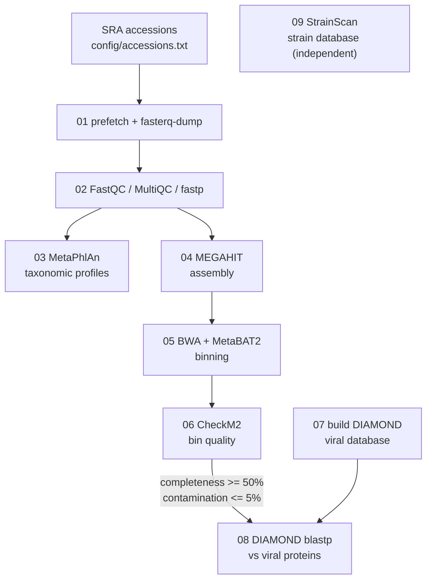

The aim of this study is to identify the plant-growth promoting microbes of the Atacama desert that can survive harsh environmental conditions. We performed large scale analysis of all the publicly available microbiome datasets (16S amplicon and Whole metagenome) of this region. The codes used for the analysis are provided here.

# Atacama Microbiome: Shotgun Metagenomics Workflow

A step-by-step, resumable shell workflow for shotgun metagenomic data. It goes from raw SRA
downloads to read QC, taxonomic profiling, assembly, binning, bin quality assessment, viral
protein screening of high-quality bins, and strain-level database construction.

## Workflow



| Step | Script | Main tools | Key output |
|------|--------|-----------|------------|
| 1 | `01_download_sra.sh` | sra-tools, pigz | `data/raw/<run>_{1,2}.fastq.gz` |
| 2 | `02_quality_control.sh` | FastQC, MultiQC, fastp | `data/trimmed/`, `results/02_qc/` |
| 3 | `03_taxonomic_profiling.sh` | MetaPhlAn | `results/03_metaphlan/merged_abundance_table.txt` |
| 4 | `04_assembly.sh` | MEGAHIT | `results/04_assembly/contigs/<run>.fa` |
| 5 | `05_binning.sh` | BWA, samtools, MetaBAT2 | `results/05_binning/<run>/bins/bin.*.fa` |
| 6 | `06_bin_quality_checkm2.sh` | CheckM2 | `results/06_checkm2/all_samples_quality_report.tsv` |
| 7 | `07_build_viral_diamond_db.sh` | DIAMOND | `databases/ncbi_viral/diamond_viral_db.dmnd` |
| 8 | `08_viral_search_bins.sh` | DIAMOND | `results/08_viral_hits/all_viral_hits.tsv` |
| 9 | `09_strainscan_build_db.sh` | StrainScan | `results/09_strainscan/<db_name>/` |

## Installation

Install [conda/mamba](https://github.com/conda-forge/miniforge), then create the environments.
MetaPhlAn and CheckM2 get their own environments because their dependencies often conflict with the rest.

```bash
git clone https://github.com/sahilrishav2/Atacama_Microbiome.git
cd Atacama_Microbiome

mamba env create -f envs/core.yml        # steps 1, 2, 4, 5, 7, 8
mamba env create -f envs/metaphlan.yml   # step 3
mamba env create -f envs/checkm2.yml     # step 6
```

**One-time database setup**

```bash
# MetaPhlAn marker database
mamba activate atacama-metaphlan && metaphlan --install

# CheckM2 database
mamba activate atacama-checkm2 && checkm2 database --download

# NCBI viral proteins for DIAMOND: handled by scripts/07_build_viral_diamond_db.sh
```

**StrainScan** (step 9) is not on conda. Clone and install it following its
[README](https://github.com/liaoherui/StrainScan), then set `STRAINSCAN_DIR` in `config/config.sh`.

## Usage

1. Put your run accessions in `config/accessions.txt` (one per line).
2. Adjust threads, memory, thresholds, and paths in `config/config.sh`.
3. Run the scripts **from anywhere**, in order, with the right environment active:

```bash
mamba activate atacama-core
bash scripts/01_download_sra.sh
bash scripts/02_quality_control.sh

mamba activate atacama-metaphlan
bash scripts/03_taxonomic_profiling.sh

mamba activate atacama-core
bash scripts/04_assembly.sh
bash scripts/05_binning.sh

mamba activate atacama-checkm2
bash scripts/06_bin_quality_checkm2.sh

mamba activate atacama-core
bash scripts/07_build_viral_diamond_db.sh   # once
bash scripts/08_viral_search_bins.sh
```

Settings can be overridden per run without editing the config, e.g. `THREADS=8 bash scripts/04_assembly.sh`.

All scripts **skip samples that already have output**, so you can re-run after a failure. If a step
crashed halfway, delete that sample's partial output files first.

### Step 9: strain database (independent of steps 1-8)

Put the genome FASTA files for one species in `data/strain_genomes/C.acnes/` (or set `STRAIN_GENOMES_DIR`), then:

```bash
bash scripts/09_strainscan_build_db.sh
```

## Repository layout

```
.
├── config/
│   ├── config.sh            # all paths, thread counts, thresholds
│   └── accessions.txt       # SRA run accessions to process
├── envs/                    # conda environment files
├── scripts/                 # numbered pipeline steps (01 ... 09)
├── data/                    # created at run time, git-ignored
├── results/                 # created at run time, git-ignored
└── databases/               # created at run time, git-ignored
```

## Methods notes

- **Trimming:** fastp with paired-end adapter detection, front and tail quality cutting, and mean quality 20.
- **Taxonomy:** MetaPhlAn on trimmed pairs with `--stat_q 0.15`, eukaryotes and archaea ignored.
- **Assembly and binning:** per-sample MEGAHIT assemblies. Trimmed reads are mapped back with BWA-MEM,
  contig depths come from `jgi_summarize_bam_contig_depths`, and bins from MetaBAT2.
- **Bin selection:** bins with completeness >= 50% and contamination <= 5% (CheckM2) are screened for
  viral proteins. Change `MIN_COMPLETENESS` / `MAX_CONTAMINATION` in `config/config.sh`.
- **Viral screening:** protein predictions from CheckM2 (`protein_files/`) are searched against NCBI
  RefSeq viral proteins with `diamond blastp --sensitive`. A hit indicates homology to viral proteins
  (e.g. prophage or viral-like genes), not by itself a complete virus, so inspect the hits before drawing conclusions.

## Tools

[SRA Toolkit](https://github.com/ncbi/sra-tools) ·
[FastQC](https://www.bioinformatics.babraham.ac.uk/projects/fastqc/) ·
[MultiQC](https://github.com/MultiQC/MultiQC) ·
[fastp](https://github.com/OpenGene/fastp) ·
[MetaPhlAn](https://github.com/biobakery/MetaPhlAn) ·
[MEGAHIT](https://github.com/voutcn/megahit) ·
[BWA](https://github.com/lh3/bwa) ·
[samtools](https://www.htslib.org/) ·
[MetaBAT2](https://bitbucket.org/berkeleylab/metabat) ·
[CheckM2](https://github.com/chklovski/CheckM2) ·
[DIAMOND](https://github.com/bbuchfink/diamond) ·
[StrainScan](https://github.com/liaoherui/StrainScan)

Please cite the original publications of these tools when you use this workflow.

## License

MIT, see [LICENSE](LICENSE).
