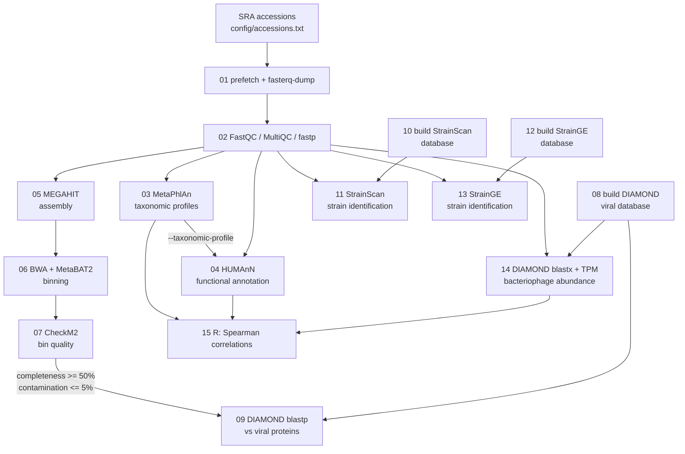
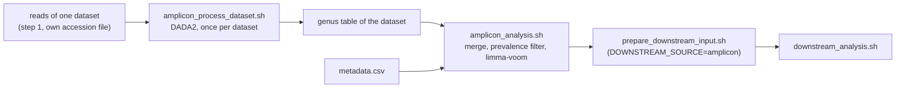

# Atacama Microbiome

The aim of this study is to identify the plant-growth promoting microbes of the Atacama desert that can survive harsh environmental conditions. We performed large scale analysis of all the publicly available microbiome datasets (16S amplicon and Whole metagenome) of this region. The codes used for the analysis are provided here.

The repository has three parts:

- **16S amplicon workflow** (`Amplicon_data/`): four R Markdown documents that take amplicon datasets from reads to a
  differential abundance test (DADA2 processing, merging of datasets, prevalence filtering, limma-voom).
  See [16S amplicon workflow](#16s-amplicon-workflow).
- **Shotgun metagenomics workflow**: a step-by-step, resumable shell workflow (steps 1-15) from raw SRA downloads to
  read QC, taxonomic profiling (MetaPhlAn), functional annotation (HUMAnN), assembly, binning, bin quality assessment,
  viral protein screening of high-quality bins, strain-level identification (StrainScan and StrainGE, including
  custom database construction), bacteriophage abundance (DIAMOND, TPM), and R scripts that correlate
  *Cutibacterium acnes* with bacteriophages and bacteriophages with bacterial pathways. It is described in the
  sections from [Workflow](#workflow) to [Troubleshooting](#troubleshooting).
- **Downstream community analysis for both data types**: `Microbial_community_analysis.Rmd` (alpha and beta diversity)
  and `Co-occurrence_network.Rmd` take a taxon abundance table from amplicon *or* shotgun data.
  See [Downstream community analysis](#downstream-community-analysis-amplicon-and-shotgun-data).

## Workflow



| Step | Script | Main tools | Key output |
|------|--------|-----------|------------|
| 1 | `01_download_sra.sh` | sra-tools, pigz | `data/raw/<run>_{1,2}.fastq.gz` |
| 2 | `02_quality_control.sh` | FastQC, MultiQC, fastp | `data/trimmed/`, `results/02_qc/` |
| 3 | `03_taxonomic_profiling.sh` | MetaPhlAn | `results/03_metaphlan/merged_abundance_table.txt` |
| 4 | `04_functional_annotation_humann.sh` | HUMAnN | `results/04_humann/merged/merged_pathabundance_cpm.tsv` (+ gene families, pathway coverage) |
| 5 | `05_assembly.sh` | MEGAHIT | `results/05_assembly/contigs/<run>.fa` |
| 6 | `06_binning.sh` | BWA, samtools, MetaBAT2 | `results/06_binning/<run>/bins/bin.*.fa` |
| 7 | `07_bin_quality_checkm2.sh` | CheckM2 | `results/07_checkm2/all_samples_quality_report.tsv` |
| 8 | `08_build_viral_diamond_db.sh` | DIAMOND | `databases/ncbi_viral/diamond_viral_db.dmnd` |
| 9 | `09_viral_search_bins.sh` | DIAMOND | `results/09_viral_hits/all_viral_hits.tsv` |
| 10 | `10_strainscan_build_db.sh` | StrainScan | `results/10_strainscan/<db_name>/` |
| 11 | `11_strainscan_identify_strains.sh` | StrainScan | `results/11_strainscan_identify/<sample>/<database>/` |
| 12 | `12_strainge_build_db.sh` | StrainGE | `results/12_strainge_db/<db_name>/<db_name>_pan-genome-db.hdf5` |
| 13 | `13_strainge_identify_strains.sh` | StrainGE | `results/13_strainge_identify/<sample>/<sample>_<database>.tsv` |
| 14 | `14_phage_abundance_tpm.sh` | DIAMOND, Python | `results/14_phage_abundance/bacteriophage_abundance_tpm.csv` |
| 15 | `15_correlation_analysis.sh` | R (corrplot, ggcorrplot, psych) | `results/15_correlation/*.png`, `*.csv` |

`scripts/setup_humann_databases.sh` is a one-time download used by step 4.

## Requirements

- Linux x86_64 (or WSL2), bash >= 4, and [conda/mamba](https://github.com/conda-forge/miniforge).
- Disk space: the HUMAnN databases are large (tens of GB), plus the MetaPhlAn, CheckM2 and NCBI viral databases and your reads.
- HUMAnN needs a fair amount of memory and time per sample; set `THREADS` to what your machine can give it.

## Installation

Each group of tools has its own environment because their dependencies often conflict.

```bash
git clone https://github.com/sahilrishav2/Atacama_Microbiome.git
cd Atacama_Microbiome

mamba env create -f envs/core.yml        # steps 1, 2, 5, 6, 8, 9
mamba env create -f envs/metaphlan.yml   # step 3
mamba env create -f envs/humann.yml      # step 4
mamba env create -f envs/checkm2.yml     # step 7
mamba env create -f envs/strainge.yml    # steps 12, 13
mamba env create -f envs/r-analysis.yml  # step 15
mamba env create -f envs/amplicon.yml    # 16S amplicon workflow
mamba env create -f envs/downstream.yml  # downstream community analysis (R Markdown documents)
```

**One-time database setup**

```bash
# MetaPhlAn marker database. The version is pinned in config/config.sh (METAPHLAN_INDEX)
# because HUMAnN 3.x only accepts profiles made with the vJun23 (or MetaPhlAn 3) database.
mamba activate atacama-metaphlan && metaphlan --install --index mpa_vJun23_CHOCOPhlAnSGB_202403

# HUMAnN databases: ChocoPhlAn, UniRef90, utility mapping (large, takes a while)
mamba activate atacama-humann && bash scripts/setup_humann_databases.sh

# CheckM2 database
mamba activate atacama-checkm2 && checkm2 database --download

# NCBI viral proteins for DIAMOND: handled by scripts/08_build_viral_diamond_db.sh
```

To keep databases outside the repository, set `HUMANN_DB_DIR` (HUMAnN) and `METAPHLAN_DB_DIR` (MetaPhlAn,
also add `--bowtie2db <dir>` to `metaphlan --install`) before running.

**StrainScan** (steps 10, 11) is run from a local clone: follow its
[README](https://github.com/liaoherui/StrainScan) to install it and its dependencies, then set
`STRAINSCAN_DIR` in `config/config.sh`.

**StrainGE** (steps 12, 13): `straingst` comes with `envs/strainge.yml`, but `prepare_strainge_db.py` is a
separate download described in the
[StrainGE database tutorial](https://strainge.readthedocs.io/en/latest/create-database.html). Save it in a folder
and set `STRAINGE_DIR` in `config/config.sh` to that folder (default `~/StrainGE`).

## Usage

1. Put your run accessions in `config/accessions.txt` (one per line). Reads must be paired-end.
2. Adjust threads, memory, thresholds, and paths in `config/config.sh`.
3. Run the scripts **from anywhere**, in order, with the right environment active:

```bash
mamba activate atacama-core
bash scripts/01_download_sra.sh
bash scripts/02_quality_control.sh

mamba activate atacama-metaphlan
bash scripts/03_taxonomic_profiling.sh

mamba activate atacama-humann
bash scripts/04_functional_annotation_humann.sh

mamba activate atacama-core
bash scripts/05_assembly.sh
bash scripts/06_binning.sh

mamba activate atacama-checkm2
bash scripts/07_bin_quality_checkm2.sh

mamba activate atacama-core
bash scripts/08_build_viral_diamond_db.sh   # once
bash scripts/09_viral_search_bins.sh

# Strain-level analysis (independent of steps 3-9, see "Strain-level analysis" below)
bash scripts/10_strainscan_build_db.sh      # in the environment where StrainScan runs
bash scripts/11_strainscan_identify_strains.sh
mamba activate atacama-strainge
bash scripts/12_strainge_build_db.sh
bash scripts/13_strainge_identify_strains.sh

mamba activate atacama-core
bash scripts/14_phage_abundance_tpm.sh      # needs steps 2 and 8

mamba activate atacama-r
bash scripts/15_correlation_analysis.sh     # needs steps 3, 4 and 14 (or your own phage table)
```

Every setting in `config/config.sh` can be overridden per run without editing it, for example
`THREADS=8 bash scripts/05_assembly.sh` or `RAW_DIR=/scratch/raw bash scripts/02_quality_control.sh`.

All scripts **skip samples that already have output**, so you can re-run after a failure. If a step
crashed halfway, delete that sample's partial output files first. Each script stops with a hint if a
required tool is missing, which usually means the wrong environment is active.

### Step 4: functional annotation

HUMAnN is run on the trimmed reads of each sample with the MetaPhlAn profile from step 3 as its
taxonomic profile, so MetaPhlAn is not run a second time. Per sample you get gene families, pathway
abundance and pathway coverage in `results/04_humann/per_sample/`. They are merged across samples and
converted to copies per million (CPM) in `results/04_humann/merged/`. To also regroup gene families
(for example to KEGG orthologs), set `HUMANN_REGROUP`:

```bash
HUMANN_REGROUP="uniref90_ko uniref90_level4ec" bash scripts/04_functional_annotation_humann.sh
```

### Strain-level analysis (steps 10-13)

These steps are independent of steps 3-9. Two tools are supported; each has one step to build a database and
one to identify strains in your samples.

| | Build a database | Identify strains | Database format |
|--|------------------|------------------|-----------------|
| StrainScan | step 10 | step 11 | a folder |
| StrainGE (StrainGST) | step 12 | step 13 | `<name>_pan-genome-db.hdf5` |

**Building a database.** Put the reference genomes of one species in a folder, then:

```bash
# StrainScan: a folder of genome FASTA files (data/strain_genomes/C.acnes, or STRAIN_GENOMES_DIR)
bash scripts/10_strainscan_build_db.sh

# StrainGE: genomes (*.fa) AND the assembly report (*.txt) in the same folder
# (data/strainge_genomes/C.acnes, or STRAINGE_GENOMES_DIR); name set by STRAINGE_DB_NAME
bash scripts/12_strainge_build_db.sh
```

Step 12 runs the standard StrainGE recipe: `prepare_strainge_db.py`, `straingst kmerize` for every genome,
`straingst kmersim --all-vs-all -S jaccard -S subset`, `straingst cluster -d -C 0.99 -c 0.90` (change with
`STRAINGE_CLUSTER_ARGS`) and `straingst createdb`. The k-mer size (`STRAINGE_KMER`, default 23) is used for the
database and for the reads, so the two always match.

**Identifying strains.** Steps 11 and 13 search *every read pair* found in `STRAIN_FASTQ_DIR` (default
`data/trimmed`) against *every database* in a list file. Read pairs can be named `<name>_1/_2`, `<name>_R1/_R2` or
`<name>_R1_001/_R2_001` (`.fastq` or `.fq`, optionally gzipped), so you can also point `STRAIN_FASTQ_DIR` at your own
FASTQ files. The list file has one database per line (blank lines and `#` comments are ignored):

```
# config/strainscan_databases.txt       StrainScan: the database folder
/full_path/E.meliloti
/full_path/A.humicireducens

# config/strainge_databases.txt         StrainGE: the path WITHOUT "_pan-genome-db.hdf5"
/full_path/E.meliloti                   (= /full_path/E.meliloti_pan-genome-db.hdf5)
```

If the list is empty, the database built by step 10 / step 12 is used. Typical calls, including the log location
and, for StrainGE, the k-mer size and an optional label added to the output names:

```bash
STRAIN_FASTQ_DIR=/path/to/fastq_files STRAINSCAN_DB_LIST=list.txt \
STRAINSCAN_LOG=/path/to/processing.log bash scripts/11_strainscan_identify_strains.sh

STRAIN_FASTQ_DIR=/path/to/fastq_files STRAINGE_DB_LIST=list.txt STRAINGE_KMER=23 \
STRAIN_OUTPUT_SUFFIX=100X_110S STRAINGE_LOG=/path/to/processing.log bash scripts/13_strainge_identify_strains.sh
```

Both steps write `processing.log` (the output of every tool run plus GNU `time -v` statistics) and
`resource_usage.tsv` (user, system and wall-clock time and peak memory of every run) into their results folder,
followed by a summary of totals. Finished runs are skipped when you run the step again, and a failed run does not stop
the others; the step reports how many failed and exits with an error at the end. StrainGE also keeps the
k-merized reads (`<sample>.hdf5`) so that a new database can be searched without repeating that step; delete them
to save space.

### Step 14: bacteriophage abundance (TPM)

Uses the viral protein database of step 8. Every trimmed read file is searched with `diamond blastx` (best hit per
read, e-value `PHAGE_EVALUE`), then `analysis/compute_phage_tpm.py` turns the hits into a phage x sample table:

1. a read pair is one fragment and is assigned to the phage of its best-scoring hit over both mates; hits below
   `PHAGE_MIN_IDENTITY` % identity are ignored;
2. a hit belongs to a phage when the organism name in square brackets at the end of the subject title (RefSeq style,
   `[Escherichia phage T4]`) matches `PHAGE_NAME_FILTER` (default `phage`);
3. `rate = fragments / total protein length of that phage in the database` and
   `TPM = rate / sum of the rates of all phages in the sample x 1,000,000`, so every sample sums to 1e6 over all
   phages detected in it;
4. phages with fewer than `PHAGE_MIN_FRAGMENTS` fragments over all samples are left out of the tables (the filter is
   applied after the TPM calculation and does not change any value).

Besides `bacteriophage_abundance_tpm.csv`, the folder has the raw fragment counts, a per-sample summary and the lengths
used. TPM here is relative to the phages detected in the same sample, not to the total sequencing depth: a sample with
few phage reads can still show a high TPM for one phage, so read the counts and the summary alongside the TPM.
This is a standard quantification and not a copy of any earlier custom calculation, so a table you already made
elsewhere may differ in values and phage names. Set `PHAGE_TPM` to use your own table in step 15.

### Step 15: correlation analyses

Step 15 runs three R scripts from `analysis/`; each can also be used on its own (`--help` lists the options).

| R script | What it does | Output |
|----------|--------------|--------|
| `prepare_correlation_inputs.R` | Takes one species (default *C. acnes*) from the merged MetaPhlAn table and the most abundant unstratified pathways from the merged HUMAnN table | `cutibacterium_abundance.csv`, `abundant_pathways.csv` |
| `correlate_cacnes_phages.R` | Spearman correlation of *C. acnes* with every phage, one-row circle plot (red = negative, blue = positive) | `cacnes_phage_correlations.csv`, `cacnes_phage_corrplot.png` |
| `correlate_phages_pathways.R` | Spearman correlation of every phage with every pathway, square-tile plot with the coefficients printed | `phage_pathway_{rho,pvalue,long}.csv`, `phage_pathway_corrplot.png` |

**Step 15 inputs.** The MetaPhlAn and HUMAnN tables come from steps 3 and 4, the bacteriophage abundance
table from step 14 (`PHAGE_TPM`, default `results/14_phage_abundance/bacteriophage_abundance_tpm.csv`); set
`PHAGE_TPM` to your own file to use a different table. All tables are CSV files with feature names in the first
column and one numeric column per sample, and the same sample IDs (the run accessions) in every table:

```
"","SRR9729086","SRR9729087", ...
"phage_01",12.5,0,...
"phage_02",3.1,8.7,...
```

The pathway selection in `prepare_correlation_inputs.R` is a parameter, not a fixed rule: by default the
20 pathways with the highest mean CPM are kept (`CORR_TOP_PATHWAYS`, or `--top-n` / `--min-prevalence` on the
script). To correlate a different species, set `CORR_SPECIES` (MetaPhlAn name without `s__`) and `CORR_LABEL`.

**Try it without running the pipeline.** `examples/toy_data/` holds small *synthetic* tables in the right formats:

```bash
mamba activate atacama-r
METAPHLAN_DIR=examples/toy_data/03_metaphlan HUMANN_DIR=examples/toy_data/04_humann \
PHAGE_TPM=examples/toy_data/bacteriophage_abundance_tpm.csv CORR_DIR=results/15_correlation_toy \
bash scripts/15_correlation_analysis.sh
```

## 16S amplicon workflow

Four R Markdown documents in `Amplicon_data/` process 16S amplicon datasets (one per study or BioProject) and compare
groups. Scripts run them with the settings of `config/config.sh`; each document also works on its own in RStudio.



| Document | What it does | Main output |
|----------|--------------|-------------|
| `Amplicon_data_processing.Rmd` | One dataset: quality filtering, ASVs (DADA2), chimera removal, SILVA taxonomy, removal of chloroplast, mitochondria and archaea (phyloseq), and a table with a `Genus` column | `<dataset>/ASVs_counts.tsv`, `ASVs_taxonomy.tsv`, `ps1_*`, `genus_tables/<dataset>.tsv` |
| `merging_multiple_count_abundance_tables.Rmd` | Merges the genus tables of all datasets | `merged_bacteria.csv` |
| `filtering_prevalent_bacteria.Rmd` | Keeps the genera present in at least `AMPLICON_PREVALENCE` (default 90%) of the samples | `merged_bacteria_90%_prevalence.csv` |
| `Differential_abundance_analysis.Rmd` | Relative abundances, then limma-voom for `AMPLICON_GROUP_A` - `AMPLICON_GROUP_B` (default Plant - Soil) | `relative_abundance_*.csv`, `diff_plant_soil.csv` |

Everything is written to `results/amplicon/` (`AMPLICON_DIR`), the HTML reports to `results/amplicon/reports/`.

```bash
# 1. Reads of ONE dataset: its own accession file and folders (reads must be paired-end)
mamba activate atacama-core
ACCESSIONS_FILE=config/accessions_studyA.txt RAW_DIR=data/amplicon/studyA SRA_DIR=data/amplicon/sra \
  bash scripts/01_download_sra.sh

mamba activate atacama-amplicon
bash scripts/setup_silva_database.sh                                       # once: SILVA 138.1 for DADA2

# 2. Per dataset. First only the read-quality plots, to choose the truncation lengths ...
bash scripts/amplicon_process_dataset.sh studyA data/amplicon/studyA
#    ... then the processing with the lengths you chose (forward, reverse)
bash scripts/amplicon_process_dataset.sh studyA data/amplicon/studyA 240 200

# 3. All datasets together (put the samples of ALL datasets in downstream_input/metadata.csv first)
bash scripts/amplicon_analysis.sh
```

`metadata.csv` has one row per sample with the columns `Sample` and `Origin` (`Plant` or `Soil`); the same file is used by the
filtering and differential abundance documents and by the downstream analysis (`downstream_input/README.md`). The
samples are named by their run accession, i.e. the part of the file name before the first `_`. To go on with the
downstream documents, run `DOWNSTREAM_SOURCE=amplicon bash scripts/prepare_downstream_input.sh`.

To try steps 3 onwards with synthetic data, see `examples/toy_data/amplicon/`.

What the documents do, so that results can be compared with earlier ones:

- The processing document ends in a genus table with the counts of `ps1`, which include the `+1` added to remove zeros.
  ASVs without a genus are dropped. This table was a manual step before; the rest of the code is unchanged.
- The merging document combines rows of the same genus with `AMPLICON_COLLAPSE` (default `mean`, as in the original code).
  The mean is taken over all rows of the genus, including the zeros filled in for the samples of the other datasets.
  Use `AMPLICON_COLLAPSE=sum` to add them up instead.
- The differential abundance document applies limma `voom` to relative abundances, as in the original code; `voom` is
  designed for read counts.
- Truncation lengths differ between datasets and must be chosen from the quality plots; the DADA2 filtering step
  and the error model are as in the original code. The filtered reads are written to `<dataset>/filtered/`.

## Downstream community analysis (amplicon and shotgun data)

Two R Markdown documents in the repository root work on any taxon abundance table, so the same documents serve the
amplicon and the shotgun data:

| Document | Analyses | Input files (see `downstream_input/README.md`) | Output in `results/downstream/` |
|----------|----------|------------------------------------------------|---------------------------------|
| `Microbial_community_analysis.Rmd` | Alpha diversity (Shannon, Simpson) by `Origin`; beta diversity as PCA of compositional data with a between-group permutation test, for plant samples (by `Plant`) and soil samples (by `Region`) | `countdata.csv`, `metadata.csv`, `countdata_plant.csv`, `metadata_plant.csv`, `countdata_soil.csv`, `metadata_soil.csv` | `Microbial_community_analysis.html` |
| `Co-occurrence_network.Rmd` | Network of taxa: Jaccard similarity between abundance profiles, keeping the 10% most similar pairs | `relative_abundance.csv`, `metadata.csv` | `Co-occurrence_network.html`, `network.graphml` (for Gephi or Cytoscape) |

**Input.** Put the tables in `downstream_input/` (formats and required columns are described there). For amplicon data
these are your final count tables and metadata. For shotgun data, step 3 gives a merged MetaPhlAn table: put your
metadata files in `downstream_input/` and let `prepare_downstream_input.sh` convert the MetaPhlAn table into the count
and abundance tables, with the samples in the order of each metadata file:

```bash
mamba activate atacama-core
bash scripts/prepare_downstream_input.sh      # shotgun only; rank: DOWNSTREAM_RANK (default species)

mamba env create -f envs/downstream.yml
mamba activate atacama-downstream
bash scripts/downstream_analysis.sh           # renders both documents
```

MetaPhlAn tables contain relative abundances (percent), not read counts. That is suitable for the analyses in these two
documents, but not for methods that need counts.

You can also open a document in RStudio and knit it or run its chunks, with the repository folder as working
directory. The input and output folders are the `params` at the top of each document (`data_dir`, `out_dir`) and, for
the script, `DOWNSTREAM_DIR` and `DOWNSTREAM_OUT_DIR`. To try everything with synthetic data, see
`examples/toy_data/downstream/`.

Notes on reproducibility:

- Input files are looked up in the input folder and, if not found there, in its sub-folders; the file name must be unique.
  A missing or ambiguous file stops the document with a message that names it.
- The permutation tests (`randtest`, 999 permutations) use a fixed seed (`seed` in the first chunk), so the p-values are
  the same on every run. The seed is not the one of any earlier run, so a p-value can differ slightly from one obtained
  before.
- Each document stops if the sample order of a count table and its metadata differ (before, this was only printed as
  `FALSE`), because the group labels would otherwise be assigned to the wrong samples.
- The figures use the font Arial, which many Linux systems lack; R then substitutes another font and the text looks slightly different.
- Each report ends with `sessionInfo()`, which lists the exact package versions used.

## Repository layout

```
.
├── config/
│   ├── config.sh            # all paths, thread counts, thresholds, database versions
│   ├── accessions.txt       # SRA run accessions to process
│   ├── strainscan_databases.txt   # databases searched by step 11 (optional)
│   └── strainge_databases.txt     # databases searched by step 13 (optional)
├── Amplicon_data/           # four R Markdown documents of the 16S amplicon workflow
├── downstream_input/        # input tables of the two documents below (formats in its README)
├── Microbial_community_analysis.Rmd   # alpha and beta diversity (amplicon or shotgun data)
├── Co-occurrence_network.Rmd          # co-occurrence network (amplicon or shotgun data)
├── envs/                    # conda environment files
├── scripts/                 # numbered pipeline steps (01 ... 15), setup_humann_databases.sh, setup_silva_database.sh, amplicon_process_dataset.sh, amplicon_analysis.sh,
│                            # prepare_downstream_input.sh, downstream_analysis.sh
├── analysis/                # step 14 (Python), step 15 (R), table conversion (Python), render_rmd.R
├── examples/toy_data/       # synthetic example tables (formats only, not real data)
├── data/                    # created at run time, git-ignored
├── results/                 # created at run time, git-ignored
└── databases/               # created at run time, git-ignored
```

## Methods notes

- **Trimming:** fastp with paired-end adapter detection, front and tail quality cutting, and mean quality 20.
- **Taxonomy:** MetaPhlAn on trimmed pairs with `--stat_q 0.15`, eukaryotes and archaea ignored, marker database
  `mpa_vJun23_CHOCOPhlAnSGB_202403`.
- **Functional annotation:** HUMAnN 3.9 on the trimmed read pairs (concatenated, as HUMAnN takes one file) with the
  MetaPhlAn profile as `--taxonomic-profile`, ChocoPhlAn pangenomes and UniRef90. Because step 3 ignores archaea and
  eukaryotes, their reads are not mapped to pangenomes and go straight to the translated UniRef90 search. Gene
  families and pathway abundances are merged and normalised to CPM.
- **Assembly and binning:** per-sample MEGAHIT assemblies. Trimmed reads are mapped back with BWA-MEM,
  contig depths come from `jgi_summarize_bam_contig_depths`, and bins from MetaBAT2.
- **Bin selection:** bins with completeness >= 50% and contamination <= 5% (CheckM2) are screened for
  viral proteins. Change `MIN_COMPLETENESS` / `MAX_CONTAMINATION` in `config/config.sh`.
- **Viral screening:** protein predictions from CheckM2 (`protein_files/`) are searched against NCBI
  RefSeq viral proteins with `diamond blastp --sensitive`. A hit indicates homology to viral proteins
  (e.g. prophage or viral-like genes), not by itself a complete virus, so inspect the hits before drawing conclusions.
- **Strain identification:** StrainScan (`StrainScan.py -i R1 -j R2 -d <database>`) and StrainGE's StrainGST
  (reads k-merized with `straingst kmerize`, then `straingst run` against a pan-genome database). Reads are searched
  against each listed database separately; compare results only between runs with the same database and settings.
- **Phage abundance:** `diamond blastx --max-target-seqs 1` of trimmed reads against RefSeq viral proteins, read pairs
  counted per phage (organism name in the subject title), length-normalised and scaled to TPM (Step 14).
- **16S amplicon workflow:** DADA2 (`fastqPairedFilter`, self-consistent error model, merging of pairs, consensus chimera removal),
  taxonomy with the SILVA 138.1 training set, removal of chloroplast, mitochondria and archaea with phyloseq, merging of the
  genus tables of all datasets, prevalence filtering, and differential abundance with limma-voom on relative abundances.
- **Downstream community analysis:** alpha diversity (Shannon, Simpson) with phyloseq; beta diversity as PCA (ade4) of compositional
  abundances with a Monte Carlo test of between-group differences (999 permutations, fixed seed); co-occurrence network
  from the Jaccard similarity of abundance profiles (vegan), keeping the 10% most similar pairs (igraph).
- **Correlations:** Spearman rank correlation on samples present in both tables. Features with zero variance are
  removed. For each analysis the p-values are corrected across all tested pairs with Benjamini-Hochberg (`q_value_BH`
  in the output tables); the plots show the correlation coefficients only. *C. acnes* vs phages uses pairwise-complete
  observations and does not plot the bacterium's correlation with itself. With fewer than 10 shared samples the
  scripts warn that the correlations are unreliable, and below 3 they stop.

## Troubleshooting

| Problem | Likely cause and fix |
|---------|----------------------|
| `command(s) not found` | The wrong conda environment is active; see the `Env:` line at the top of the script. |
| Step 4 stops with "was not made with the MetaPhlAn vJun23 (or v3) database" | The step 3 profiles came from another marker database (MetaPhlAn >= 4.2 defaults to vJan25, which HUMAnN 3.9 rejects). Delete the old profiles in `results/03_metaphlan/` and re-run step 3 with the pinned `METAPHLAN_INDEX`. |
| HUMAnN complains about the ChocoPhlAn version | The ChocoPhlAn folder is from an older release. Delete `databases/humann/chocophlan` and re-run `scripts/setup_humann_databases.sh`. |
| Steps 11/13: "no read pairs found" | `STRAIN_FASTQ_DIR` holds no matching pairs. File names must follow `_1/_2`, `_R1/_R2` or `_R1_001/_R2_001`; unpaired R1 files are reported and skipped. |
| Step 12: "no assembly report" or "prepare_strainge_db.py not found" | `STRAINGE_GENOMES_DIR` needs the genomes (`*.fa`) and the assembly report (`*.txt`); download `prepare_strainge_db.py` and set `STRAINGE_DIR` (see Installation). |
| Step 13: "StrainGE database not found" | List the database path without `_pan-genome-db.hdf5` (or give the `.hdf5` file), or build it with step 12. |
| A sample is skipped with "not found (run step N)" | The input of that step is missing for the sample; run the earlier step first. |
| Step 14: "no organism matching 'phage'" or "no phage has at least N fragments" | The viral FASTA has no `[organism]` tags or no phage names, or very few reads hit. Check `PHAGE_NAME_FILTER`, lower `PHAGE_MIN_FRAGMENTS`, and look at `bacteriophage_sample_summary.tsv`. |
| Step 15: "Need at least 3 shared samples" | Sample IDs differ between the tables. For MetaPhlAn names, adjust `--metaphlan-suffix` of `prepare_correlation_inputs.R`. |
| Amplicon: "set trunc_len_f and trunc_len_r" | Call `amplicon_process_dataset.sh` with the two truncation lengths; run it without them first to get the quality plots. |
| Amplicon: "Silva training file not found" | Run `scripts/setup_silva_database.sh` (or set `SILVA_DB`). |
| Amplicon: "sample order of the metadata and of the abundance table differ" | The samples of `metadata.csv` must be in the same order as the columns of the filtered table (the order of the genus tables). Reorder the metadata rows. |
| Downstream: "Input file not found" or "Input file name is not unique" | The table is not in `downstream_input/` (or the folder set by `DOWNSTREAM_DIR`), or the same name exists in several sub-folders. See `downstream_input/README.md` for the expected names. |
| Downstream: the document stops at `stopifnot(identical(...))` | The columns of the count table and the samples of the metadata are in a different order or have different IDs. Fix the files so that they match. |
| Plot labels are cut off | Set `--width` / `--height` for the R scripts. |

## Tools

[SRA Toolkit](https://github.com/ncbi/sra-tools) ·
[FastQC](https://www.bioinformatics.babraham.ac.uk/projects/fastqc/) ·
[MultiQC](https://github.com/MultiQC/MultiQC) ·
[fastp](https://github.com/OpenGene/fastp) ·
[MetaPhlAn](https://github.com/biobakery/MetaPhlAn) ·
[HUMAnN](https://github.com/biobakery/humann) ·
[MEGAHIT](https://github.com/voutcn/megahit) ·
[BWA](https://github.com/lh3/bwa) ·
[samtools](https://www.htslib.org/) ·
[MetaBAT2](https://bitbucket.org/berkeleylab/metabat) ·
[CheckM2](https://github.com/chklovski/CheckM2) ·
[DIAMOND](https://github.com/bbuchfink/diamond) ·
[StrainScan](https://github.com/liaoherui/StrainScan) ·
[StrainGE](https://github.com/broadinstitute/strainge) ·
R packages [dada2](https://github.com/benjjneb/dada2), [limma](https://bioconductor.org/packages/limma/), [corrplot](https://github.com/taiyun/corrplot), [ggcorrplot](https://github.com/kassambara/ggcorrplot), [psych](https://cran.r-project.org/package=psych), [phyloseq](https://github.com/joey711/phyloseq), [microbiome](https://github.com/microbiome/microbiome), [vegan](https://github.com/vegandevs/vegan), [igraph](https://igraph.org/r/), [ade4](https://cran.r-project.org/package=ade4) and [factoextra](https://cran.r-project.org/package=factoextra)

Please cite the original publications of these tools when you use this workflow, in particular
MetaPhlAn 4 (Blanco-Míguez et al., *Nat Biotechnol* 2023), HUMAnN 3 / bioBakery 3 (Beghini et al., *eLife* 2021),
StrainScan (Liao et al., *Microbiome* 2023), StrainGE (van Dijk et al., *Genome Biol* 2022), DADA2 (Callahan et al.,
*Nat Methods* 2016), SILVA (Quast et al., *Nucleic Acids Res* 2013), phyloseq (McMurdie and Holmes, *PLoS ONE* 2013) and
limma-voom (Law et al., *Genome Biol* 2014).

## License

MIT, see [LICENSE](LICENSE).
